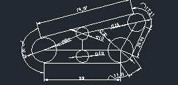

# 계단 주행 휠체어 설계·제작

2021년 동양미래대학교에서 약 3개월 동안 진행한 팀 프로젝트입니다. 호출하면 사용자에게 이동하고, 계단도 오를 수 있는 휠체어를 목표로 만들었습니다.

- 맡은 일: AutoCAD·SolidWorks로 바퀴와 프레임 설계, 프로파일 절단·조립, 주행 시험
- 결과: 2021 동양미래 EXPO 최우수상(팀 공동 수상), 삼성 코엑스 전시

## 제작 과정

계단을 오르려면 바퀴가 계단을 딛는 각도와 프레임 구조를 같이 맞춰야 했습니다. AutoCAD와 SolidWorks로 바퀴와 프레임을 설계한 뒤 프로파일을 잘라 조립했습니다.

조립해서 주행해 보니 도면에서 생각한 대로 움직이지 않았습니다. 바퀴가 계단에 걸리거나 프레임과 부딪혔고, 그때마다 바퀴 형상과 각도, 프레임 간격을 고쳐 다시 조립하고 시험했습니다. 한 곳을 바꾸면 이어진 부품도 다시 맞춰야 해서 이 과정을 여러 번 반복했고, 결국 계단을 오르는 시제품을 완성했습니다.

## CAD 파일

당시 메일에 남아 있던 설계 파일을 그대로 올렸습니다.

| 폴더 | 내용 |
| --- | --- |
| [cad/solidworks](cad/solidworks) | 바퀴, 롤러, 프레임, 실린더, 리벳 등 부품 18개와 조립 파일 2개 |
| [cad/autocad](cad/autocad) | 무한궤도 바퀴, 무한궤도 옆면 도면 2개 |

전체 목록은 [docs/file_inventory.md](docs/file_inventory.md)에 있습니다.

| 무한궤도 바퀴 | 무한궤도 옆면 |
| --- | --- |
|  |  |

DWG 파일에 들어 있던 미리보기 이미지입니다.

`.SLDPRT`, `.SLDASM`은 SolidWorks로, `.dwg`는 AutoCAD로 열 수 있습니다. 조립 파일은 처음 열 때 부품 경로를 다시 지정해야 할 수 있습니다.
