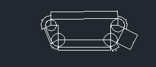
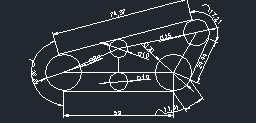

# 계단 주행 휠체어 제작 (2021)

기계공학과 재학 중 약 3개월간 팀으로 진행한 설계·제작 프로젝트입니다. 호출에 따라 이동하고 계단을 오르는 휠체어를 목표로 했습니다. 저는 CAD와 SolidWorks를 이용한 바퀴·프레임 설계, 프로파일 절단과 조립, 주행 시험에 참여했습니다.

- **활동:** 2021 동양미래대학교 팀 프로젝트 (약 3개월)
- **수상:** 2021 동양미래 EXPO(제39회 졸업작품 전시회) 최우수상, 팀 공동 수상
- **전시:** 삼성 코엑스

## 제작하면서 확인한 문제

도면상으로는 조립이 가능해 보였지만 실제로 제작한 뒤에는 바퀴가 계단을 딛는 각도와 프레임 사이 간격 때문에 원하는 대로 움직이지 않는 경우가 있었습니다. 프로파일을 다시 자르거나 부품을 분해해야 해서 시간이 걸렸지만, 주행이 막히는 구간을 확인하고 바퀴 형상과 간격을 수정한 뒤 다시 시험했습니다. 여러 번의 수정과 조립을 거쳐 계단 주행이 가능한 시제품을 완성했습니다.

## 남아 있는 설계 자료

프로젝트 당시 사용했던 파일 중 메일에 남아 있던 자료를 모았습니다. **완성품 도면 일체나 수정 이력이 모두 보존된 것은 아닙니다.** 아래 파일들은 설계와 제작 과정에서 다뤘던 부품·구조를 확인하는 용도입니다.

| 분류 | 남아 있는 파일 | 참고 사항 |
| --- | --- | --- |
| 바퀴·구동부 | `앞바퀴370`, `뒷바퀴 350`, `롤러`, `축` | 파일명에 있는 숫자를 실측 치수로 단정하지 않음 |
| 프레임 | `상부 프레임`, `하부 프레임`, `시저 프레임` 부품 | 상·하부 구조와 연결부 관련 설계 자료 |
| 구동·연결부 | `실린더 원통`, `실린더 스트로크`, `판베어링`, `리벳` 파일 | 부품별 다양한 모델이 남아 있음 |
| 조립 | `어셈블리1.SLDASM`, `컨버전스.SLDASM` | 조립 원본. 일부 외부 참조가 누락됐을 가능성 있음 |
| 2D 도면 | 무한궤도 바퀴와 측면 배치 DWG | 설계 검토 자료. 최종 시제품 적용 여부는 확인되지 않음 |

원본은 [`cad/solidworks`](cad/solidworks)와 [`cad/autocad`](cad/autocad)에 보관했습니다.

## 설계 변경을 돌아보면

남아 있는 파일에는 바퀴 도면뿐 아니라 프레임과 연결부의 여러 모델이 있습니다. 실제 제작 과정에서도 바퀴만 수정하면 끝나는 것이 아니라 프레임과의 간섭, 부품을 연결하는 위치를 함께 살펴야 했습니다. 한 부분을 바꾼 뒤 전체 구조가 제대로 움직이는지 다시 조립하고 시험했던 점이 기억에 남습니다.

`하부 프레임 예시1`과 `하부 프레임 파트1`, `판베어링`과 `판베어링25`처럼 이름과 내용이 다른 파일이 남아 있습니다. 다만 어느 파일이 먼저 만들어졌고 어떤 것이 최종 채택됐는지는 현재 자료만으로 알 수 없습니다. 리벳의 여러 파일도 **단순히 날짜순 수정본이 아니라 규격별 부품일 수 있으므로**, 모두 별도 모델로 보관했습니다.

*위 그림은 DWG에 저장된 작은 미리보기이며, 전체 도면의 치수·형상을 재구성한 그림은 아닙니다.*

## 자료 사용 시 참고

- SolidWorks 원본은 이 환경에서 완전히 열어 조립 관계와 치수를 검증하지 못했습니다.
- 일부 파일은 검토안 또는 중간 부품일 수 있습니다. 모든 파일이 최종 작품에 들어갔다고 주장하지 않습니다.
- 팀 전체의 결과와 제가 맡았던 작업을 구분해 기술했습니다.
- 다른 팀원의 이름이 포함된 상장 원본은 공개 저장소에서 제외했습니다.
- 휠체어의 적재하중, 안전 인증, 주행 속도 등 시험 기록이 없는 성능 수치는 기재하지 않았습니다.
